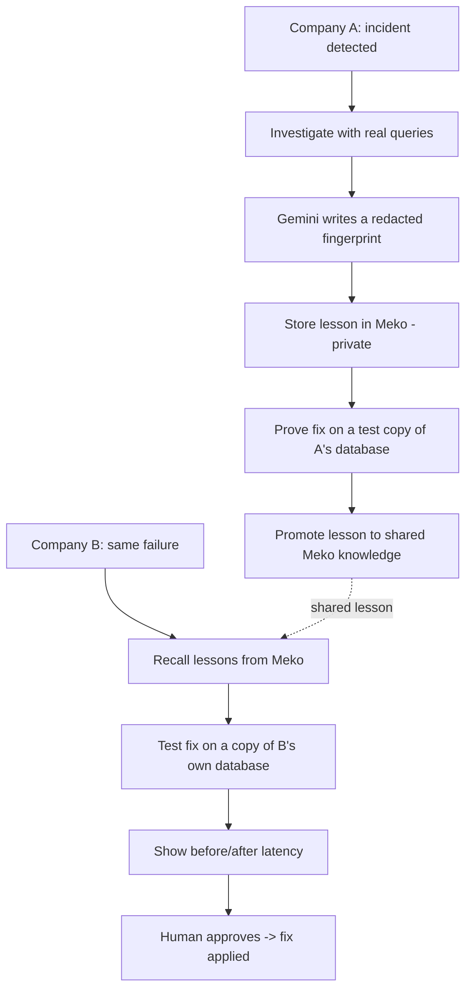

# HackCBS-2026

# Outage Herd Immunity

> **When one company survives an outage, every company becomes immune.**

A shared fix network for database outages. When Company A resolves an incident, an anonymized lesson is stored and shared through Meko. When Company B hits the same failure, the lesson is recalled, the fix is **tested on an isolated copy of B's own database**, and a human approves it with before/after numbers on screen. Nothing touches production automatically.

Built for **HackCBS 9.0 — Meko Track A**.

---

## 1. The problem

Every company relearns the same production outages alone.

When a database incident happens, an on-call engineer has to work out the cause from scratch, even when another company already hit the identical failure and published the fix. Today's tools don't close that gap:

- **AI SRE tools learn only from your own history.** A company's *first* encounter with a failure gets no help.
- **Public postmortems are blog posts.** They're scattered, written for reading rather than matching, and nobody finds them in the middle of an outage.
- **Best-practice guides only help if you adopted them in advance.**

The result: the same failure patterns keep causing outages at different companies, with fixes that already exist.

## 2. How a user experiences this problem

Priya is the on-call backend engineer at a mid-size SaaS company.

1. A routine deploy goes out. Minutes later, API latency climbs and dozens of alerts fire at once.
2. She opens dashboards, logs and the database console, trying to find which of the alerts actually matter.
3. She suspects the database, but can't immediately see why. Is it a slow query, a lock, or connection exhaustion?
4. She tries fixes on production under pressure, because there's no safe place to test them quickly.
5. Forty-five minutes later she finds the cause. A week later, she learns another company published a postmortem about exactly this failure months ago.

**What she needed:** "Someone has already solved this. Here's their fix, already tested on a copy of *your* database: latency drops from 2.4 s to 40 ms. Approve?"

## 3. Evidence that the problem exists

### On-call teams are overloaded

| Finding | Source |
| --- | --- |
| Most engineering teams spend **40%+ of their time** on incident management; **77%** of on-call teams get 10+ alerts a day, and **57%** say fewer than 30% are actionable (survey of 1,039 SRE/DevOps professionals, Feb 2026) | [2026 State of Production Reliability report, via Carrier Management](https://www.carriermanagement.com/news/2026/04/08/286535.htm) |
| Nearly **40%** of organizations say more than a quarter of their on-call engineers show burnout symptoms tied to incident management | [Pagerly summary of the same report](https://www.pagerly.io/blog/alert-fatigue-reliability-risk-2026-08-10) |

### Repeated incidents cost as much as new ones

| Finding | Source |
| --- | --- |
| In 2,000+ Sev 0–2 cloud incident investigations at Microsoft, repeated incidents (same symptom, root cause and fix as a past one) took about **as long to resolve as new ones**. The authors attribute this to the lack of a framework for reusing knowledge from past investigations | [Mining Root Cause Knowledge from Cloud Service Incident Investigations (arXiv 2204.11598)](https://arxiv.org/pdf/2204.11598) |
| In a year of incidents at a Microsoft email service, **93.8%** of recurring incidents reappeared within 20 days | [Automatic Root Cause Analysis via LLMs for Cloud Incidents (arXiv 2305.15778)](https://arxiv.org/pdf/2305.15778) |
| In the Verica Open Incident Database (VOID), only about **a quarter** of public incident reports identified a root cause, and reports are scattered across company websites | [DevOps.com on the VOID launch](https://devops.com/verica-launches-database-for-sharing-it-incident-reports/) |

### The same failure, different companies, same year

| Date (2026) | Company | What failed | Impact |
| --- | --- | --- | --- |
| 19 Oct | [LLM Gateway](https://llmgateway.io/blog/incident-report-october-19-2026) | A Postgres migration with no lock timeout queued behind queries that had run for 7+ hours; every query on the table queued behind it | Dashboard and API down **48 min** |
| 15 Mar | [Autumn](https://useautumn.com/blog/post-mortem-database-outage-caused-by-collation-migration-locking-conflict) | A collation change stopped Postgres from using indexes; the rollback `ALTER TABLE` was blocked by locks held by active queries | **~10%** of API requests failed for 75 min |
| 29 Jan | [Open Build Service](https://openbuildservice.org/2026/02/02/post-mortem/) | A large migration caused lock-wait timeouts on MariaDB | All users affected for **~1 h 45 min** |

LLM Gateway's own report says that with a lock timeout, the migration would have failed in seconds and left the service running. **The fix was known. It didn't reach them in time.** That is the gap this project closes.

## 4. How our architecture solves it

### The loop

1. **Detect:** an alert arrives through a serverless function, and an incident is opened.
2. **Investigate:** the system runs read-only queries (`pg_stat_statements`, `pg_locks`, metrics) and records each finding with the exact query and result as evidence.
3. **Fingerprint:** Gemini turns the resolved incident into a structured lesson (root-cause class, metric pattern, fix template) and removes identifying details such as table names, hostnames and query text.
4. **Prove:** the fix is applied to a zero-copy fork of the database and measured. The lesson is shared only if the fix works.
5. **Share:** the proven lesson is promoted from Company A's private memory into the shared knowledge base.
6. **Recall and re-prove:** when Company B fails the same way, it recalls the lesson, then re-tests the fix on a fork of *its own* database, because a fix from another company is never trusted blindly.
7. **Approve:** a human sees the evidence and the before/after numbers, then clicks approve.

### Why this is trustworthy

- **Proof over prediction:** every fix is measured on an isolated database copy before anyone can approve it.
- **Humans decide:** nothing is applied to production automatically.
- **Private by design:** only redacted lessons cross company boundaries, never raw data.
- **Honest context:** the dashboard shows only what Meko actually returned.

### How each tool is used

| Tool | Job |
| --- | --- |
| **Meko** | Private memory per company; promotion of proven lessons to shared knowledge; recall before investigating |
| **Tiger Data** | Postgres for each demo company; metrics time series; zero-copy forks to test fixes |
| **Gemini API** | Fingerprint extraction and redaction; investigation reasoning |
| **YugabyteDB** | Distributed registry of incidents, fingerprints, validation status and the approval audit log |
| **DigitalOcean** | Serverless functions for ingest and matching; hosting for the apps and dashboard |
| **MongoDB Atlas** (stretch) | Alert storage and grouping |

### Meko Track A requirements

| Requirement | How we meet it |
| --- | --- |
| Context changes the outcome | Company B recovers faster because it recalls Company A's proven lesson |
| At least 3 real Meko uses | **Store** (`memory_add`), **share** (`memory_promote`), **recall** (`context_search` / `knowledgebase_search`) |
| Meko ON vs OFF demo | Company B's incident is run with Meko off (investigates from zero) and on (recalls the lesson); both times are shown |
| Visible context | Dashboard "Memory" panel shows what was recalled, stored and shared |
| Honest and private | Redaction before storing; only real Meko results are displayed |
| New Meko feature proposal | **Verified memories** (below) |

### Proposed Meko feature: verified memories

Today a memory is just text. We propose memories that carry **proof**:

- **Validation status:** `proven on test copy`, `failed on test copy`, or `not yet tested`
- **Attached evidence:** the test conditions and the measured before/after result
- **Trust score:** rises each time another datapack independently confirms the lesson

This lets an agent tell the difference between *tested evidence* and *an unverified suggestion*, which matters most when memories are shared between teams.

## 5. How we measure success

All numbers below are measured in the prototype. They show the system works in our demo environment; they are **not** claims about real-world production results.

| Metric | What it shows | How we measure it | Result |
| --- | --- | --- | --- |
| **Time to proven fix, Meko ON vs OFF** | Shared context changes the outcome | Time from Company B's first alert to a proven fix, averaged over 5 runs in each mode | _to be measured_ |
| **Fix effect on the test copy** | The fix actually works | p95 latency before vs after, on the fork | _to be measured_ |
| **Correct recall** | The right lesson is retrieved | Share of runs where the top recalled lesson matches the injected failure | _to be measured_ |
| **Redaction** | Nothing private crosses companies | Automated check for table names, hostnames and query text in every shared lesson; target 0 leaks | _to be measured_ |
| **Repeatability** | Results are reliable | Same scenario, 5 runs: variation in the measured latencies | _to be measured_ |
| **No unapproved changes** | Safety holds | Count of fixes applied to production without approval; target 0 | _to be measured_ |

## 6. Scope

**MVP:** two demo companies; one failure type (missing index usage); fingerprint, store, prove, share, recall, re-prove, approve.

**Next, if time allows:** a second failure type (lock-holding migration, the LLM Gateway pattern); a Gemini-driven investigation agent; 3–5 real public postmortems uploaded as seed knowledge; alert grouping.

**Not in scope:** non-database incidents, real customer integrations, automatic fixes, multi-tenant accounts.

## 7. Limitations

- Two simulated companies stand in for a network of many.
- Only database failures are covered, because those can be tested on a fork.
- Redaction is a best-effort automated check, not a formal privacy guarantee.
- Matches to real public incidents are shown only where the failure genuinely matches.

## 8. Running it

_To be added: setup steps, environment variables, and the deployed URL._

## 9. Team

## Deep Thinkers
