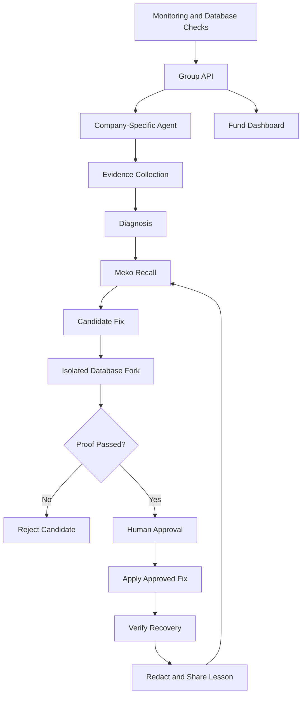

# ☁️ Outage Herd Immunity

> **When one company in a portfolio survives an outage, every sister company becomes immune.**

A shared fix network for companies within one venture fund. Each company runs its own agent. When Company A resolves a database incident, its agent converts the resolution into a redacted, proven lesson and shares it with the group through Meko. When Company B encounters the same failure, its agent recalls the lesson, independently proves the fix on an isolated copy of B's own database, and waits for human approval before applying anything.

**Learn collectively. Verify independently. Recover safely.**

Built for **HackCBS 9.0 – Meko Track A** by **Team Deep Thinkers**.

---

## 🚀 Project Links

| Resource | Link |
|---|---|
| 🌐 Live Web Application | [Outage Herd Immunity](https://outage-herd-immunity.vercel.app) |
| ⚙️ Backend API | [Render API](https://fixnet-api-onrender-com.onrender.com) |
| 📊 Project Presentation | [View Pitch Deck](https://docs.google.com/presentation/d/1ZgGjjp2oV1QApp1yfQ0diA4yTC_tFK6L/edit?usp=sharing&ouid=105195433318570626140&rtpof=true&sd=true) |

---

## 1. The Problem

**Companies in the same portfolio keep relearning the same production failures independently, even when a sister company has already discovered and proven the fix.**

Companies backed by the same venture fund often use similar databases, cloud services, infrastructure and software ecosystems. Consequently, they experience recurring failures such as:

- Missing database indexes after deployments.
- Long-running transactions and database lock contention.
- Database connection exhaustion.
- Sudden API latency spikes.
- Vulnerable dependencies and exposed secrets.

Each time, an on-call engineer starts investigating from scratch.

### Why existing approaches fall short

- **Isolated AI SRE tools:** Learn primarily from one company's own incident history.
- **Traditional postmortems:** Store valuable knowledge in documents and blogs that are difficult to retrieve during an active outage.
- **Unsafe automation:** A suggested fix cannot simply be trusted and applied to another company's production environment.
- **Knowledge silos:** Venture funds lack a unified view of recurring technical risks across their portfolio companies.

The result is repeated engineering effort, longer recovery cycles and preventable service disruptions.

## 2. Who Experiences This Problem?

| Stakeholder | Problem | What Outage Herd Immunity provides |
|---|---|---|
| On-call Engineers | Repeatedly investigate similar incidents under pressure | Evidence-backed diagnosis and independently verified candidate fixes |
| DevOps / SRE Teams | Limited visibility into recurring infrastructure problems | Shared incident intelligence across portfolio companies |
| Fund Platform Teams | Cannot identify common risks across companies | Group-level risk monitoring and proven lesson visibility |
| Founders and CTOs | Downtime, operational costs and engineering overhead | Faster recovery and reusable operational knowledge |

### Example Scenario

Imagine Priya, an engineer at Tealbox, experiences a database latency spike.

Pinecart has already encountered a similar problem and discovered that a missing index was responsible.

Instead of starting from zero, Tealbox's agent recalls the relevant lesson, tests the candidate fix on its own isolated database copy, and presents the evidence to Priya.

Priya approves the fix only after reviewing the proof.

**Knowledge travels across companies. Production data does not.**

## 3. Evidence That the Problem Exists

The problem of repeated incidents, alert fatigue and slow incident resolution is documented in real-world engineering research and industry reports.

### On-call teams are overloaded

| Finding | Source |
|---|---|
| Engineering teams spend significant time managing incidents; 77% of surveyed on-call teams receive 10+ alerts daily. | [2026 State of Production Reliability Report](https://www.carriermanagement.com/news/2026/04/08/286535.htm) |
| Nearly 40% of organizations report burnout symptoms among more than a quarter of their on-call engineers. | [Pagerly – Reliability Risk 2026](https://www.pagerly.io/blog/alert-fatigue-reliability-risk-2026-08-10) |

### Repeated incidents are expensive

| Finding | Source |
|---|---|
| Research involving 2,000+ Microsoft cloud incident investigations found that repeated incidents took approximately as long to resolve as new incidents. | [Mining Root Cause Knowledge from Cloud Service Incident Investigations](https://arxiv.org/pdf/2204.11598) |
| Research on recurring cloud incidents reported that 93.8% of recurring incidents reappeared within 20 days in the studied service. | [Automatic Root Cause Analysis via LLMs for Cloud Incidents](https://arxiv.org/pdf/2305.15778) |
| Public incident reports frequently lack structured root-cause information, making reusable operational knowledge difficult to discover. | [Verica Open Incident Database](https://devops.com/verica-launches-database-for-sharing-it-incident-reports/) |

### Real-world examples

- **LLM Gateway:** A PostgreSQL migration caused a database outage lasting 48 minutes. [Incident report](https://llmgateway.io/blog/incident-report-october-19-2026)
- **Autumn:** A database collation migration created index and locking issues, causing API request failures. [Postmortem](https://useautumn.com/blog/post-mortem-database-outage-caused-by-collation-migration-locking-conflict)
- **Open Build Service:** A large migration resulted in MariaDB lock-wait timeouts. [Postmortem](https://openbuildservice.org/2026/02/02/post-mortem/)

These incidents demonstrate why operational knowledge should be reusable, searchable and independently verifiable.

## 4. Our Solution: Outage Herd Immunity

Outage Herd Immunity creates a shared learning network between portfolio companies without sharing their private production data.

### The Core Workflow

1. **Detect:** Monitoring tools and scheduled database checks identify production issues.
2. **Investigate:** Each company's agent gathers evidence using read-only database access.
3. **Diagnose:** Deterministic rules classify the issue, while Gemini generates a human-readable explanation.
4. **Recall:** Meko searches for a matching proven lesson from another company.
5. **Prove:** The candidate fix is tested on an isolated copy of the affected company's database.
6. **Approve:** An engineer reviews the evidence and explicitly approves the fix.
7. **Apply:** The approved fix is executed and its postconditions are checked.
8. **Learn:** A redacted lesson is stored and shared with the portfolio group.
9. **Improve:** Future companies can independently validate and confirm the same lesson.

### The Five Production Tests

| # | Test | Detection / Tool |
|---|---|---|
| 1 | Latency Spike | Prometheus + Alertmanager |
| 2 | Missing Database Index | Scheduled PostgreSQL checks |
| 3 | Long-running Transactions | check_postgres |
| 4 | Database Connections Near Limit | check_postgres |
| 5 | Vulnerable Packages and Exposed Secrets | Trivy |

The first two tests support the automated candidate-fix and isolated-proof workflow. The remaining tests are surfaced with evidence for engineering review rather than receiving unverified automated fixes.

### Why Our Architecture Is Safe

- **Proof before approval:** Every candidate fix must pass verification on an isolated database copy.
- **Human-in-the-loop:** An engineer must explicitly approve the fix.
- **Company isolation:** Each agent accesses only its own company's database.
- **Privacy:** Only redacted lessons are shared; raw customer and production data remain private.
- **Evidence-backed decisions:** AI explanations are grounded in collected evidence rather than unrestricted autonomous execution.

## 5. System Architecture and Technology Stack

| Component | Technology | Responsibility |
|---|---|---|
| Frontend | React, TypeScript, Vite | Engineer dashboard and fund administration interface |
| Backend | Python, FastAPI | API, authentication, findings, incidents and approvals |
| AI | Google Gemini | Diagnosis explanations and lesson generation |
| Shared Memory | Meko | Store, share and recall lessons |
| Registry | YugabyteDB | Companies, incidents, lessons, trust scores and audit trail |
| Findings Store | MongoDB Atlas | Findings and similarity-based retrieval |
| Monitoring | Prometheus | Metrics collection |
| Alerting | Alertmanager | Incident alerts |
| Visualization | Grafana | Monitoring dashboards |
| Security Scanning | Trivy | Dependency and exposed-secret scanning |
| Database Prover | Tiger Data | Isolated database forks for candidate-fix verification |
| Backend Hosting | Render | Publicly hosted Group API |
| Frontend Hosting | Vercel | Publicly hosted web application |

### High-Level Architecture



## 6. Measuring Success

Our goal is to demonstrate that shared operational knowledge reduces investigation effort without compromising safety.

| Metric | What We Measure | Target |
|---|---|---|
| Time to Proven Fix | Meko ON versus OFF | ON measurably faster |
| Proofs per Incident | Number of candidate proofs required | One recalled candidate versus multiple independent candidates |
| Fix Effectiveness | Before/after p95 latency on isolated copy | Significant improvement |
| Production Recovery | Real traffic latency after approved fix | Below 500 ms within 2 minutes |
| Correct Recall | Relevant lesson returned for the injected failure | 5/5 runs |
| Redaction | Sensitive identifiers in shared lessons | Zero |
| Unauthorized Execution | Fixes applied without approval | Zero |
| Company Isolation | Cross-company incident access | Always denied |
| Repeatability | Variation across repeated demo runs | Consistent results |

**Important:** Performance targets are experimental goals, not claims of already achieved production results. Measurements will be recorded across repeated demo runs.

## 7. Meko Integration – Track A

Meko provides the shared memory layer that allows companies to learn from each other's operational experiences.

### Three Core Meko Operations

1. **Store:** A successfully validated and redacted lesson is stored in shared memory.
2. **Share:** The lesson is promoted to the portfolio group's knowledge base.
3. **Recall:** Another company's agent searches for a matching lesson during an incident.

### Meko ON vs OFF

| Meko ON | Meko OFF |
|---|---|
| Agent recalls matching shared lessons | Agent investigates from scratch |
| Candidate fix can be narrowed using prior knowledge | Candidate fixes must be independently investigated |
| Shared context is available | Shared recall is disabled |
| Isolated proof remains mandatory | Isolated proof remains mandatory |

Meko never bypasses verification or human approval.

### Proposed Meko Enhancement: Verified Memories

We propose that shared memories carry:

- Validation status: proven, failed or not yet tested.
- Attached evidence: test conditions and before/after measurements.
- Trust score: increases when independently confirmed by other companies.

This would help AI agents distinguish verified operational knowledge from untested suggestions.

## 8. Limitations and Scope

- The current demonstration uses two fictional portfolio companies: Pinecart and Tealbox.
- Automated candidate fixes focus on database problems that can be verified using isolated database forks.
- Other detected issues are surfaced with evidence for human investigation.
- Automated redaction is a safety mechanism, not a formal privacy guarantee.
- Public postmortem lessons are treated as untested references until independently verified.

## 9. Running the Project

### Live Services

| Service | URL |
|---|---|
| Frontend | https://outage-herd-immunity.vercel.app |
| Backend API | https://fixnet-api-onrender-com.onrender.com |
| Backend API Documentation | https://fixnet-api-onrender-com.onrender.com/docs |

The free Render service may take approximately a minute to respond after an extended idle period.

### Local Development

**Frontend**

```bash
cd frontend
npm install
```

Create a `.env.local` file:

```env
VITE_USE_MOCKS=false
VITE_API_URL=https://fixnet-api-onrender-com.onrender.com
```

Start the development server:

```bash
npm run dev
```

Build for production:

```bash
npm run build
```

**Backend**

The backend uses FastAPI. Refer to the `backend/` directory for setup instructions and required environment variables.

Do not commit secrets, database credentials, API keys or `.env` files to GitHub.

## 10. Team

### Team Deep Thinkers

| Team Member | Responsibility |
|---|---|
| Person 1 | Demo companies, detection, monitoring and database prover |
| Neha Saini – Person 2 | Group API, company agents, Meko integration and backend orchestration |
| Vriti – Person 3 | Frontend web application, dashboards and API integration |

---

## Our Vision

**One company's outage should become every company's opportunity to recover faster.**

Outage Herd Immunity transforms isolated incident knowledge into shared, evidence-backed intelligence — while keeping every company's data, decisions and production systems under its own control.

**Learn collectively. Verify independently. Recover safely.**
